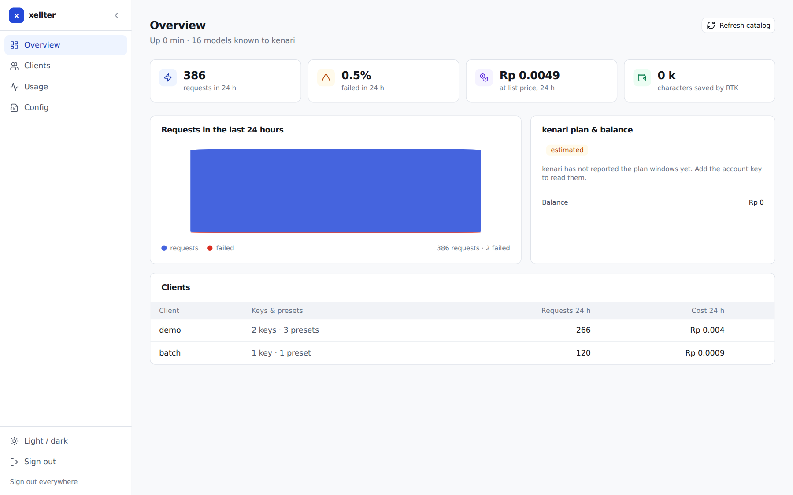
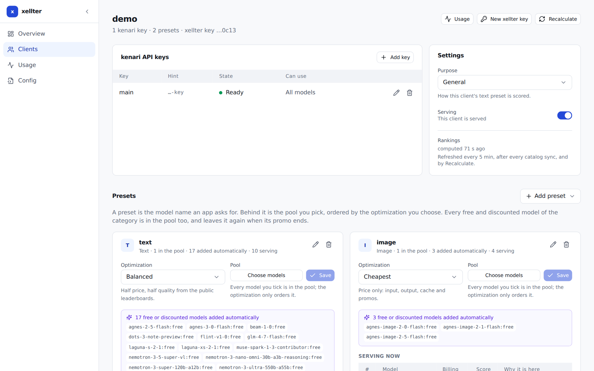
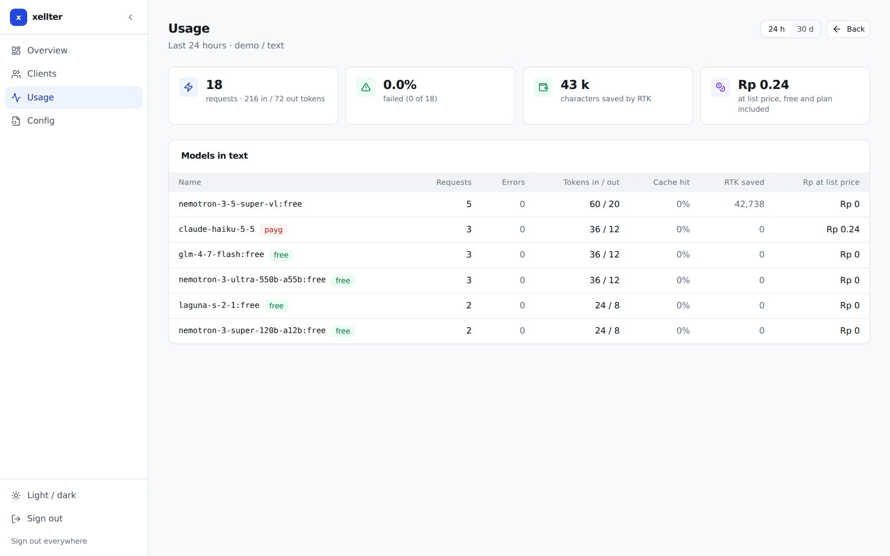

# xellter

A small LLM gateway in front of [kenari.id](https://kenari.id). An app calls an OpenAI-compatible
endpoint with its own xellter key and asks for a **preset name** the owner chose (`text`, `image`, …);
xellter picks a real model from that preset's pool, keeps one model per conversation unless the
owner says otherwise, retries a failure once, and takes a model out of that preset when it errs, is
unreliable or is slow. One static Go binary, SQLite, no runtime dependencies.

## The three optimizations

A preset is a **pool of models** plus **one optimization**, and the preset has a name of your own.
Ranking only orders the pool; it never removes a model for being cheap, expensive or unknown. Every
free model and every model whose promo is running is in the pool of every preset of that category,
whether you tick it or not, and leaves it again when the promo ends.

| Optimization | Order | The list |
|---|---|---|
| Cheapest | reference cost ascending, nothing else | half free + half plan-covered (5 + 5 at the default `top_models: 10`), each half by its own cost |
| Balanced | 50 % cost score, 50 % benchmark | top 10 (the default) |
| Best Quality | benchmark of the category only, floor at the pool median | top 10, models with no evidence excluded (a free or discounted model is never excluded for that) |

Cost is one number: the price of one reference request (for chat, 4 000 input tokens of which 70 %
are cache reads, plus 600 output tokens), promos included. Text quality comes from public
leaderboards fetched by xellter — Arena, SWE-bench Verified, Aider polyglot — never typed by the
owner. A client's purpose (General, Coding, Agentic, Vision & documents, Bulk) chooses the text
sources and never changes pool membership. Media presets (image, video, TTS, STT, music, System One)
have no public score wired into the ranking yet, so they order by cost and Best Quality serves
nothing there.

## Also

- **Routing.** Round-robin over the preset's top 10, session pinning (one model per conversation),
  retry once on a retriable error, then the next model. Rankings rebuild every 5 minutes, after each
  catalog sync, and from the panel's Recalculate button.
- **A model that does badly goes out of the preset.** Per client and preset: three errors in a row in
  an hour take it out for 12 hours; a median first token above 10 s, or 40 % of its requests failing,
  take it out for 30 minutes (ADR 0029). It comes back on its own with a clean record; if it is bad
  again it goes out for twice as long. A preset is never emptied: the last two models stay in. The
  panel lists who is out, why and when they return.
- **A silent stream fails over.** A streamed chat answer that sends no first token within 15 s (plus
  1 s per 10 000 prompt tokens) is cancelled and the next model is tried. A conversation whose pinned
  model is slow for two of its last three requests moves to another model.
- **Sticky session, per preset.** A preset keeps one model for the whole conversation, so the
  provider's prompt cache stays warm — that is the default. Turn the toggle off on a preset that
  should spread its traffic: every turn is routed again, and the whole pool is used. One client can
  hold a sticky preset and a roaming one at the same time.
- **RTK.** Tool output (`git diff`, `grep`, `ls`, logs, oversized text) is compressed before it is
  sent. Always on, no switch.
- **Plan numbers.** With an optional full-access account key, plan windows and balance come straight
  from kenari and sit next to xellter's own accounting.
- **Panel.** Overview, Clients, Usage, Config file. Login: username + password (scrypt) + TOTP.

## The panel

Three screens, one per job: what is happening now, what a client may call, what it spent.

**Overview** — uptime, 24-hour requests, the plan budget and the balance next to xellter's own
accounting, and one row per client.



**A client** — its kenari keys with their live state, and its presets; the preset shows the models
it may call, why the order is what it is, and the model it is serving right now. Each preset card
carries the sticky-session toggle, next to its optimization and its pool.



**Usage** — per model, preset, key or client, with the price of each and the split between plan,
pay-as-you-go and free.



## Run

```bash
make build                                     # -> bin/xellter (needs Go 1.27+)
install -d -m 700 data
./bin/xellter admin init -credentials-out data/FIRST-LOGIN.txt
./bin/xellter client add -name demo -out data/demo.key
echo 'kn-...' | ./bin/xellter key add -client demo -name main
./bin/xellter serve                            # http://127.0.0.1:8480/
```

Then open the panel, create the presets this client needs (one per category) and tick their models.

Upgrading an old config:

```bash
./bin/xellter migrate -config xellter.yaml -write   # old file kept as xellter.yaml.pre-rewrite
```

## API

Base URL `https://xellter.example.com/v1` (locally `http://127.0.0.1:8480/v1`). Every call carries
the client's key as a bearer token, `Authorization: Bearer $XELLTER_KEY`; there is no other
authentication on the data plane.

`Content-Type: application/json` on a request; the answer is kenari's own JSON, relayed. xellter
never translates a protocol and never rewrites a field except `model` (see chat) and
`stream_options.include_usage` on a streamed chat request.

### Errors

One shape on every endpoint except `/v1/messages`, which keeps the Anthropic shape a client of that
protocol expects:

```json
{"error":{"message":"unknown model \"nope\"","type":"xellter_error","code":"model_not_found"}}
```

```json
{"type":"error","error":{"type":"model_not_found","message":"unknown model \"nope\""}}
```

| Status | `code` | When |
|---|---|---|
| 400 | `bad_request` | a body that cannot be read, an empty one, a bad `range` |
| 401 | `invalid_api_key` | missing or unknown key; a disabled client answers 403 |
| 404 | `model_not_found` | the name is neither a preset of this client nor a model in its pools |
| 404 | `no_search_key` | `/v1/x/search` from a client without a key for that service |
| 404 | `no_session` | `/v1/session` for a session that has no traffic yet |
| 405 | `method_not_allowed` | a known path with the wrong method, or any other path |
| 413 | `body_too_large` | the body is over `server.max_body_mb` |
| 429 | `no_capacity` | no key of the client can take the request now (rate, quota or plan limit); carries `Retry-After` |
| 503 | `no_candidates` | the preset has no usable model right now |
| 503 | `all_evicted` | every model of the preset is out after errors or slowness |
| 503 | `upstream_unavailable` | every attempt failed; carries `Retry-After` |

A path that is not one of the endpoints below is refused with 405/404 and **never forwarded**. It
would otherwise reach kenari as a model call, and its failure would count against every model of
the preset (ADR 0024).

### Response headers

| Header | On | Meaning |
|---|---|---|
| `X-Xellter-Model` | chat, System One, media | the real model that answered, not the preset you asked for |
| `X-Xellter-Attempt` | chat, System One, media, search | which attempt answered: `1`, or higher after a retry or a move to another model |
| `X-Xellter-Attempts` | a failed call | how many attempts were spent before giving up |
| `Retry-After` | 503, 429 | seconds to wait |

### Chat — `POST /v1/chat/completions`, `/v1/responses`, `/v1/messages`

The body is forwarded unchanged except `model`, which must be a **preset name**, not a kenari model.
The three paths speak OpenAI chat, OpenAI Responses and Anthropic messages respectively; xellter
treats them alike and returns what kenari returned, streaming included.

```bash
curl https://xellter.example.com/v1/chat/completions \
  -H "Authorization: Bearer $XELLTER_KEY" -H 'Content-Type: application/json' \
  -H 'X-Xellter-Session: chat-42' \
  -d '{"model":"text","messages":[{"role":"user","content":"hello"}]}'
```

```json
{
  "id": "chatcmpl-...", "object": "chat.completion", "created": 1793104835,
  "model": "claude-haiku-5-5",
  "choices": [{"index": 0, "message": {"role": "assistant", "content": "Hello."}, "finish_reason": "stop"}],
  "usage": {"prompt_tokens": 12, "completion_tokens": 4, "total_tokens": 16}
}
```

Response headers: `X-Xellter-Model: claude-haiku-5-5`, `X-Xellter-Attempt: 1`.

`X-Xellter-Session` (or `X-Session-Id`, or `X-Claude-Code-Session-Id`) pins one model for the
conversation. Without it the pin follows `prompt_cache_key`, then `user`, then a hash of the first user
message (ADR 0030). Send your own id when you can: a client that compresses its history changes its first
message, and a session id survives that. With one you can also ask about the conversation later with
`/v1/session`. Pins are saved in the database, so a restart does not move a conversation.

### Media — `POST /v1/images/*`, `/v1/audio/speech`, `/v1/audio/transcriptions`, `/v1/videos`, `/v1/music`

Same contract: `model` is a preset of that category, the body goes through untouched, the answer is
kenari's (JSON for images and speech, SSE for music, multipart in, JSON out for transcriptions).
`X-Xellter-Model` names the model that served it.

### System One — `POST /v1/systemone`

kenari publishes System One on a catalogue of its own, so it is a category of its own and a client holds
one `systemone` preset next to its `chat` preset. `model` is that preset; the body and the answer are
kenari's, passed through as-is. A systemone preset is served by this path and by the chat paths
(`/v1/chat/completions`, `/v1/responses`, `/v1/messages`), because kenari serves System One through the
OpenAI-shaped endpoint too. This path refuses every other category.

```bash
curl https://xellter.example.com/v1/systemone \
  -H "Authorization: Bearer $XELLTER_KEY" -H 'Content-Type: application/json' \
  -d '{"model":"classify","input":"the battery dies in an hour"}'
```

### X search — `POST /v1/x/search`

A custom endpoint: the X (Twitter) search is a service kenari bills per call from the account
balance, not a model, so nothing is ranked and no preset is involved. The request and the answer are
kenari's own, forwarded byte for byte — xellter adds no field and reads none. The call is served by
the client's key marked `capability: search`:

```yaml
keys:
  - name: main
    key_env: KENARI_KEY_DEMO_MAIN
  - name: X-search
    key_env: KENARI_KEY_DEMO_X_SEARCH
    capability: search        # never probed, never in a pool, never serves a model
```

A capability key exists because xellter asks kenari which models a key may call, and a
pay-as-you-go key must not be charged for that curiosity. The key is spent only on the calls the
client actually made.

```bash
curl https://xellter.example.com/v1/x/search \
  -H "Authorization: Bearer $XELLTER_KEY" -H 'Content-Type: application/json' \
  -d '{"query":"latest Rust release"}'
```

```json
{"answer":"- @someone: Rust 1.95 is out ...","citations":[{"url":"https://x.com/..."}],"cost_micro_idr":100000000}
```

kenari documents a `503` here as "failed to return a usable answer, not charged, retry", so xellter
retries up to three times (700 ms, then 1.8 s apart) and reports the attempts in
`X-Xellter-Attempt`. A `429` is retried the same way. Every other status is the answer and goes back
to the client untouched, error included. One successful search is logged as one paid row
(`x/search`, Rp 100 at the time of writing) and appears in `/v1/usage`; a failed one is not charged
and therefore not counted.

### Models — `GET /v1/models`, `GET /v1/models/{id}`

The list a client needs to pick a model: its presets first (`"preset": true`), then the real kenari
models its pools can reach, with the catalogue price of each.

```json
{
  "object": "list",
  "data": [
    {"id": "text", "object": "model", "owned_by": "xellter", "modality": "chat", "preset": true,
     "description": "balanced over 1 models", "context_length": 1000000,
     "tool_call": true, "vision": true, "reasoning": true},
    {"id": "claude-haiku-5-5", "object": "model", "owned_by": "kenari", "modality": "chat",
     "context_length": 1000000, "tool_call": true, "vision": true, "reasoning": true,
     "pricing": {"currency": "IDR", "unit": "micro_idr_per_1m_tokens",
                 "input": 2500000000, "output": 12500000000, "cache_read": 250000000,
                 "cache_write": null}}
  ]
}
```

A preset advertises what its whole pool can do (the owner's list plus the free and promo models added on
their own): the **largest** context window any model in it has, and a capability only if every model has
it. The largest, because the preset is a name that may resolve to any of them, and a smaller number made
clients compress their history for a window the serving model never had (ADR 0026). Media models carry `lines` (per image, per second, per 1k
characters) instead of token prices. `/v1/models/{id}` returns the single item, or 404.

### Session — `GET /v1/session?session=<id>`

Which real model that conversation is using, what it has cost, and every model it has tried.

```json
{
  "object": "session", "session": "demo-01", "client": "demo", "preset": "text",
  "model": "agnes-2-5-flash:free", "vendor": "agnes", "billing": "free",
  "context_window": 512000, "modalities": "text+image", "tool_call": true, "pinned_at": 0,
  "requests": 5, "errors": 0, "in_tok": 245484, "out_tok": 6011, "cached_tok": 0,
  "cost_idr": 390.5375, "last_model": "agnes-2-5-flash:free",
  "models": ["claude-haiku-5-5", "agnes-2-5-flash:free"]
}
```

`model` is the live pin; `last_model` is what the log last recorded. `billing` is `free`, `plan` or
`balance`. The id comes from `?session=` or from the same headers a normal request uses; a session
with no traffic answers 404 `no_session`.

### Usage — `GET /v1/usage?range=24h|30d`

Kenari's own usage shape, filled from xellter's request log, so a client written against kenari
reads it unchanged. `range` is `24h` (since midnight, the default) or `30d`; anything else is a 400.
Only successful requests count — a failed attempt never reached a model.

```json
{
  "object": "usage.summary", "start": 1793059200, "end": 1793104809,
  "data": [
    {"billing_kind": "free", "model": "agnes-2-5-flash:free", "requests": 8,
     "prompt_tokens": 555295, "completion_tokens": 8776, "cached_prompt_tokens": 0,
     "cache_write_prompt_tokens": 0, "catalog_micro_idr": 0, "cost_micro_idr": 0},
    {"billing_kind": "plan", "model": "claude-haiku-5-5", "requests": 5,
     "prompt_tokens": 138955, "completion_tokens": 2662, "cached_prompt_tokens": 0,
     "cache_write_prompt_tokens": 0, "catalog_micro_idr": 380662500, "cost_micro_idr": 0}
  ],
  "total": {"requests": 15, "prompt_tokens": 846587, "completion_tokens": 14038,
            "cached_prompt_tokens": 0, "cache_write_prompt_tokens": 0,
            "catalog_micro_idr": 380662500, "cost_micro_idr": 0}
}
```

`catalog_micro_idr` is the list price of that traffic at the price of the moment; `cost_micro_idr` is
what was actually paid, so it is `0` for a free model and for plan-covered traffic, and equal to the
catalogue price for pay-as-you-go. Rows are sorted by requests, then model.

### Usage per key and per model

```bash
GET /v1/usage/keys            # split by the kenari key that served it
GET /v1/usage/models?preset=text
```

```json
{"object":"usage.keys","start":1793059200,"end":1793104843,
 "data":[{"api_key":"…0c13","client":"demo","requests":15,"errors":2,"in_tok":846587,
          "out_tok":14038,"cached_tok":0,"rtk_saved":55959,"cost_idr":380.6625}]}
```

`api_key` is the key's hint, never the key. Same `range` rule; `usage/models` filters by `preset`
when given.

### Account — `GET /v1/account/balance`, `GET /v1/account/quota`

Kenari's account state, answered from what xellter already keeps rather than asking kenari per call.

```json
{"object":"account.balance","currency":"IDR","available_micro_idr":0,
 "balance_micro_idr":0,"reserved_micro_idr":0}
```

```json
{"alert_pct":50,"coupon":null,
 "plan":{"name":"Kreator","windows":{"week":{"budget_rp":150000,"used_rp":50000,
         "remaining_rp":100000,"used_frac":0.3333,"resets_at":"2026-11-02T00:00:00Z"}}}}
```

`plan` is absent until an account key is configured: without one xellter cannot read the windows.
Money is micro-Rupiah throughout (`1_000_000` micro = Rp 1).

### Health — `GET /healthz`

No key, no client. For a load balancer or a monitor.

```json
{"ok":true,"models":120,"catalog_age_s":31,"degraded":false}
```

`503` with `{"ok":false,"reason":"catalog not loaded"}` until the first catalogue sync lands;
`degraded` means the last sync failed and the snapshot is stale.

### Panel

The panel is at the root of the host and its JSON API at `/api`; it is not the data plane. It
answers only for the `Host` values in `server.admin_hosts` and needs a login (password + TOTP), so a
public name serves `/v1/*` and `/healthz` and returns 404 for everything else.

## Documentation

| File | Contents |
|---|---|
| [docs/architecture.md](docs/architecture.md) | components, request flow, ranking maths, routing, endpoints, panel |
| [docs/configuration.md](docs/configuration.md) | every config key, and what is refused |
| [docs/operations.md](docs/operations.md) | deploy, Tailscale, runbook, what to do when models are slow or failing, backups, security model |
| [docs/plan.md](docs/plan.md) | phase status, what is deliberately not done, known gaps |
| [docs/adr/](docs/adr/) | architecture decision records |
| [skills/xellter/SKILL.md](skills/xellter/SKILL.md) | how to operate xellter (for LLM agents) |
| [AGENTS.md](AGENTS.md) | rules for AI coding agents working on this repo |

## Develop

```bash
./scripts/ci.sh   # builds the panel, gofmt, vet, tests, the backup script test; no network, no paid calls
```

## License

MIT, see [LICENSE](LICENSE).
